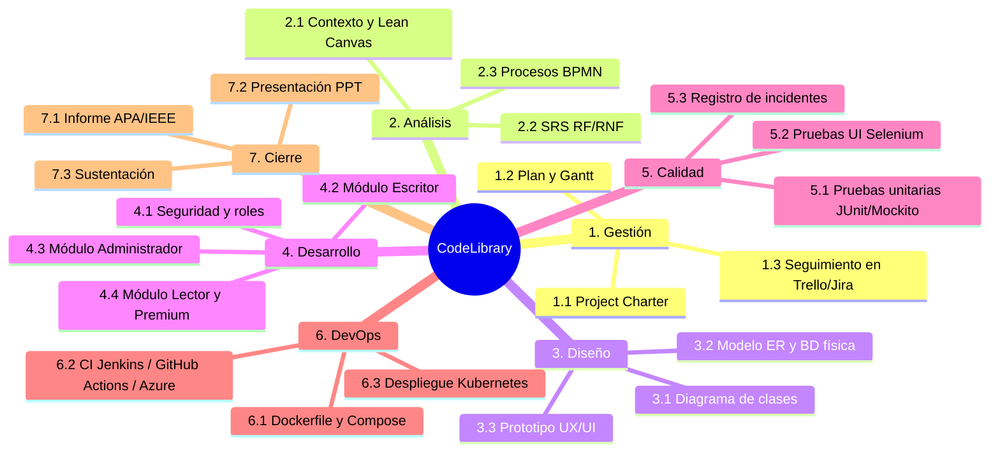
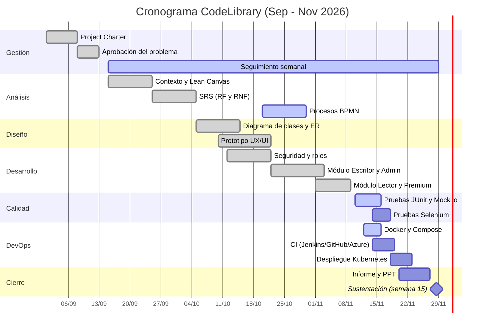

# WBS y Diagrama de Gantt

> Los diagramas están en Mermaid: se visualizan directamente en GitHub. Para el informe, exporta una captura o recréalos en Lucidchart/Trello/Asana.

## WBS (Estructura de Desglose del Trabajo)

## Diccionario WBS (resumen)
| Código | Paquete de trabajo | Entregable | Responsable |
|---|---|---|---|
| 1.1 | Project Charter | `01-project-charter.md` | [Líder] |
| 2.2 | SRS | `03-srs.md` | [Completar] |
| 2.3 | Procesos BPMN | `04-bpm-procesos.md` | [Completar] |
| 3.1–3.2 | Clases y ER | `05`, `06` | [Completar] |
| 4.x | Desarrollo | Código en `src/main` | [Completar] |
| 5.1 | Pruebas unitarias | `src/test` | [Completar] |
| 6.x | DevOps | Dockerfile, Jenkinsfile, `.github`, `azure-pipelines.yml`, `k8s/` | [Completar] |
| 7.x | Cierre | Informe + PPT | Todos |

## Gantt

