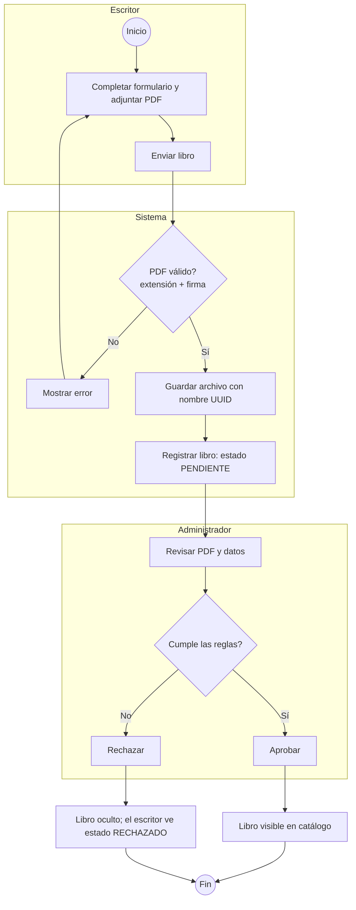
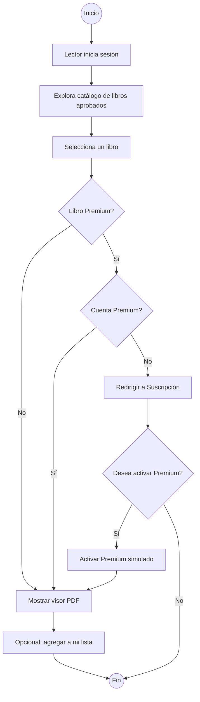
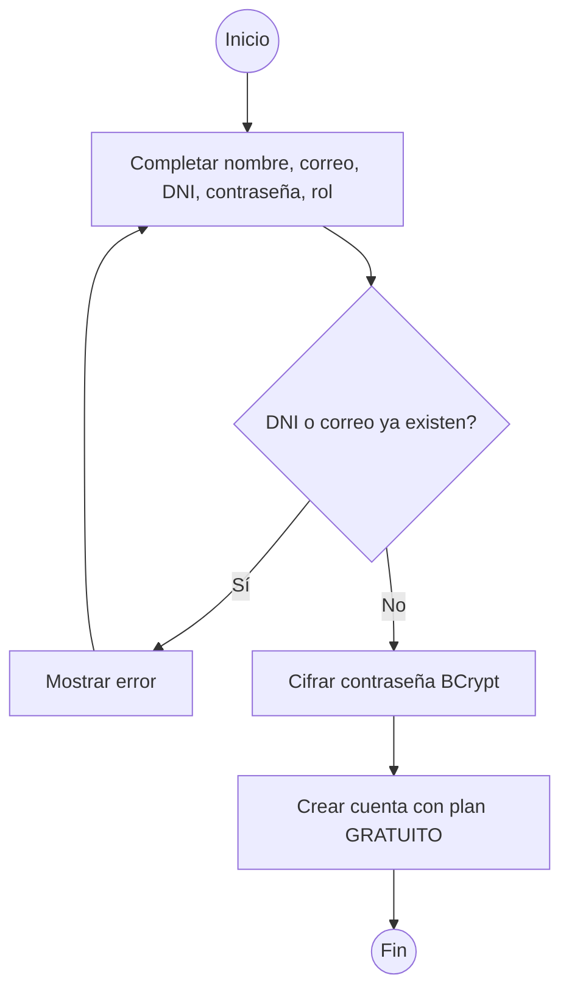

# Modelado de procesos de negocio (BPM / BPMN 2.0)

**Notación usada.** Evento de inicio (círculo), actividad (rectángulo redondeado), compuerta exclusiva XOR (rombo con ✕), evento de fin (círculo grueso), *pools/lanes* por participante. Los diagramas siguientes usan Mermaid como aproximación visual; para la entrega final se recomienda redibujarlos en **Bizagi Modeler, Camunda Modeler o Lucidchart** con notación BPMN formal.

## Proceso 1: Publicación y moderación de un libro (TO-BE)

## Proceso 2: Lectura de un libro con control de plan

## Proceso 3: Registro de usuario

## Explicación de elementos BPMN usados
| Elemento | Ejemplo en el modelo | Significado |
|---|---|---|
| Evento de inicio / fin | Inicio, Fin | Dónde comienza y termina el proceso |
| Tarea | "Revisar PDF y datos" | Trabajo realizado por un participante |
| Compuerta exclusiva (XOR) | "¿Libro Premium?" | Solo un camino según una condición |
| Carril (lane) | Escritor / Sistema / Administrador | Responsable de cada actividad |
| Flujo de secuencia | Flechas | Orden de ejecución |
