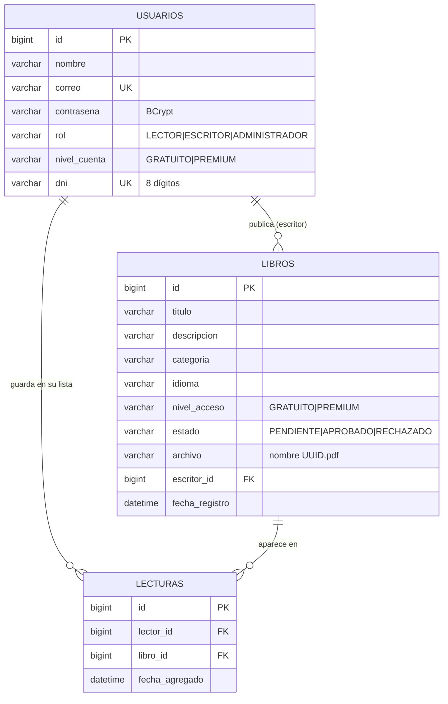

# Diseño de la base de datos

Motor: MySQL / MariaDB — esquema `biblioteca_virtual`. Las tablas las genera Hibernate (`ddl-auto=update`); el script de abajo es el diseño físico equivalente.

## Diseño lógico — Modelo Entidad-Relación



**Reglas:** un usuario escritor publica muchos libros; un lector guarda muchos libros y un libro está en muchas listas (relación N:M resuelta con `lecturas`); la pareja (`lector_id`, `libro_id`) es única.

## Diseño físico (DDL)

```sql
CREATE DATABASE IF NOT EXISTS biblioteca_virtual CHARACTER SET utf8mb4;
USE biblioteca_virtual;

CREATE TABLE usuarios (
  id            BIGINT AUTO_INCREMENT PRIMARY KEY,
  nombre        VARCHAR(255) NOT NULL,
  correo        VARCHAR(255) NOT NULL UNIQUE,
  contrasena    VARCHAR(255) NOT NULL,
  rol           VARCHAR(20)  NOT NULL DEFAULT 'LECTOR',
  nivel_cuenta  VARCHAR(20)  NOT NULL DEFAULT 'GRATUITO',
  dni           VARCHAR(8)   NOT NULL UNIQUE
);

CREATE TABLE libros (
  id              BIGINT AUTO_INCREMENT PRIMARY KEY,
  titulo          VARCHAR(255)  NOT NULL,
  descripcion     VARCHAR(1000),
  categoria       VARCHAR(255)  NOT NULL,
  idioma          VARCHAR(255),
  nivel_acceso    VARCHAR(20)   NOT NULL DEFAULT 'GRATUITO',
  estado          VARCHAR(20)   NOT NULL DEFAULT 'PENDIENTE',
  archivo         VARCHAR(255),
  escritor_id     BIGINT,
  fecha_registro  DATETIME      NOT NULL,
  CONSTRAINT fk_libros_escritor FOREIGN KEY (escritor_id) REFERENCES usuarios(id)
);
CREATE INDEX idx_libros_estado ON libros(estado, fecha_registro);

CREATE TABLE lecturas (
  id             BIGINT AUTO_INCREMENT PRIMARY KEY,
  lector_id      BIGINT   NOT NULL,
  libro_id       BIGINT   NOT NULL,
  fecha_agregado DATETIME NOT NULL,
  CONSTRAINT uq_lector_libro UNIQUE (lector_id, libro_id),
  CONSTRAINT fk_lecturas_lector FOREIGN KEY (lector_id) REFERENCES usuarios(id),
  CONSTRAINT fk_lecturas_libro  FOREIGN KEY (libro_id)  REFERENCES libros(id)
);
```

## Consideraciones de seguridad de la base de datos
- Contraseñas **solo** como hash BCrypt (nunca texto plano).
- `correo` y `dni` únicos: evitan cuentas duplicadas.
- Los PDF **no** se guardan en la BD: solo su nombre aleatorio (`archivo`); el binario va a un volumen.
- Credenciales de la BD por variables de entorno / Secrets de Kubernetes, no en el repositorio.
- Recomendación para producción: usuario de BD con privilegios mínimos (no `root`), copia de seguridad periódica del volumen, `ddl-auto=validate`.
