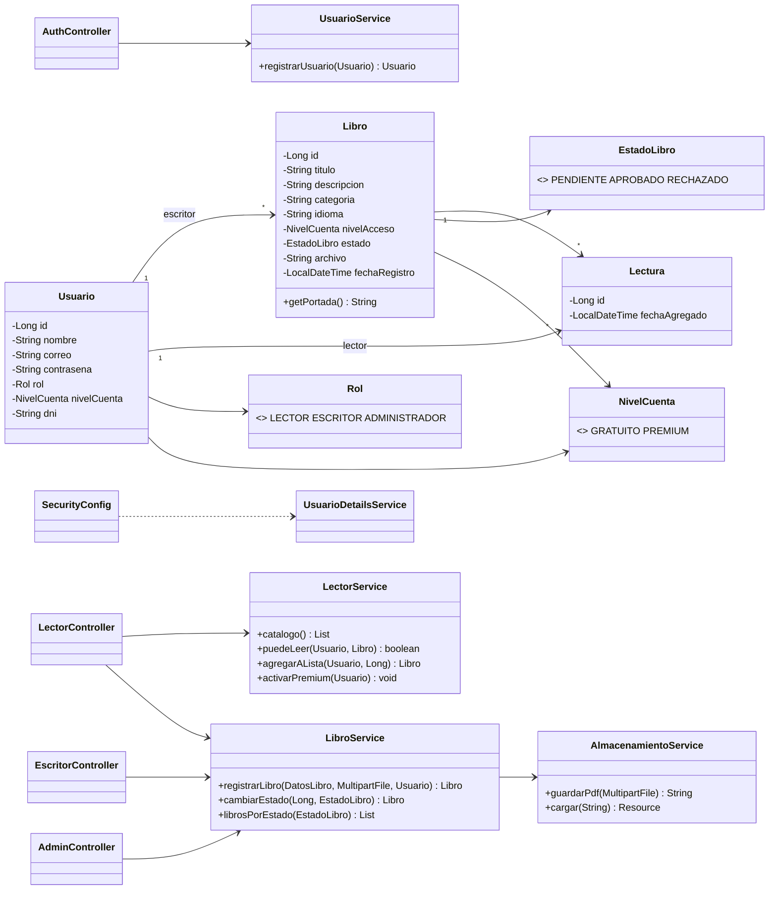

# Diagrama de clases (según el código fuente)

## Patrones y buenas prácticas aplicadas
- **Arquitectura en capas MVC**: Controller → Service → Repository.
- **Inyección de dependencias por constructor** (facilita las pruebas con Mockito).
- **Repository (Spring Data JPA)** para el acceso a datos.
- **Enumeraciones** para roles, planes y estados (evita "strings mágicos").
- **Record** `DatosLibro` como objeto de transferencia de datos del formulario.
