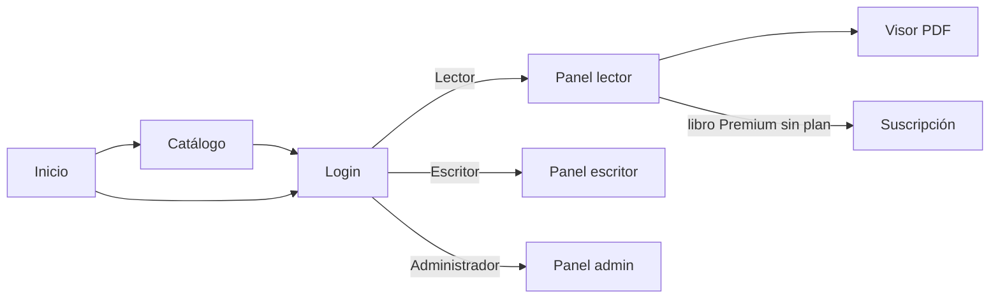

# Diseño UX/UI y reportes

Herramienta de prototipado sugerida: **Balsamiq / Figma** (wireframes) y las plantillas Thymeleaf ya implementadas como prototipo funcional.

## Pantallas implementadas (prototipo funcional)
| N.º | Pantalla | Ruta | Plantilla | Rol |
|---|---|---|---|---|
| 1 | Inicio | `/` | `index.html` | Público |
| 2 | Login y registro | `/login` | `login.html` | Público |
| 3 | Catálogo | `/catalogo` | `catalogo.html` | Público |
| 4 | Categorías | `/categorias` | `categorias.html` | Público |
| 5 | Planes / Suscripción | `/suscripcion` | `suscripcion.html` | Público |
| 6 | Panel del lector (mi lista y catálogo) | `/lector` | `lector.html` | Lector |
| 7 | Visor de libro | `/lector/libros/{id}/leer` | `leer.html` | Lector |
| 8 | Panel del escritor | `/escritor` | `escritor.html` | Escritor |
| 9 | Panel del administrador | `/admin` | `admin.html` | Administrador |

## Flujo de navegación

## Criterios de diseño
- Interfaz responsiva con Bootstrap 5; fragmento común `fragments/layout.html` (barra de navegación y pie).
- Mensajes de éxito/error tras cada acción (*flash messages*).
- Portadas por categoría con clases CSS (`cover-blue`, `cover-orange`, …).
- Accesibilidad básica: etiquetas en formularios, contraste suficiente, campos `required`.
- Cada rol ve solo su panel; los intentos de acceso indebido se redirigen a `/login`.

## Reportes clave
| Reporte | Contenido | Quién | Estado |
|---|---|---|---|
| Indicadores del administrador | Total de usuarios, libros aprobados, libros pendientes | Administrador | Implementado en `/admin` |
| Mis publicaciones | Libros del escritor con su estado | Escritor | Implementado en `/escritor` |
| Mi lista de lectura | Libros guardados del lector | Lector | Implementado en `/lector` |
| Reporte de ejecución de pruebas | Resultados JUnit (`target/surefire-reports`) | Equipo | Generado por CI |
| Reporte de libros por categoría (propuesto) | Conteo por categoría y estado | Administrador | Propuesto |

## Documentación para desarrolladores y usuarios
- Desarrolladores: `README.md`, `docs/` (este conjunto de documentos), comentarios en el código.
- Usuarios: guía rápida — registrarse → elegir libro → leer; escritores: publicar → esperar aprobación.
